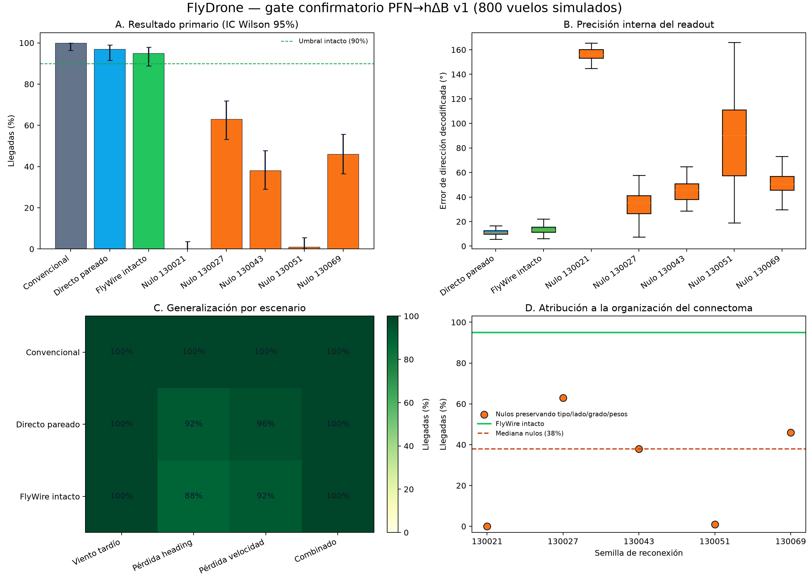
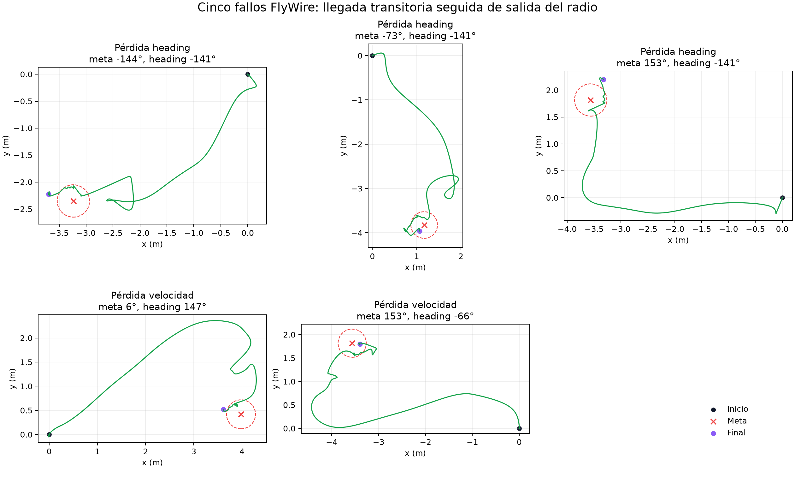

# Resultado confirmatorio PFN→hΔB v1

## Conclusión

El gate confirmatorio congelado fue aprobado en sus cuatro niveles. En 800 vuelos simulados, el controlador PFN→hΔB con conectividad FlyWire intacta alcanzó 95/100 metas, frente a una mediana de 38/100 para cinco reconexiones nulas que conservaron tipo PFN, lado, grados y distribución de pesos. La ventaja confirmatoria fue de 57 puntos porcentuales, por encima de los 20 puntos preregistrados, y el intacto también superó el percentil 95 de los nulos (59,6%).

Este resultado demuestra que, **dentro de este modelo computacional y protocolo simulado**, la organización concreta de la proyección PFN→hΔB aporta información funcional para compensar deriva. No demuestra superioridad sobre control convencional, equivalencia completa con la fisiología de la mosca ni funcionamiento en un dron físico.



## Protocolo congelado

- Identificador: `flydrone_pfn_hdelta_confirmatory_v1`.
- Configuración: `configs/quadrotor_connectome_confirmatory.yaml`.
- Lock SHA-256: `df37bf86636ff4f1e92ee197dadf8e7fdb2b4902bb531bc9ea8acdd4eb705698`.
- Resultado: 800 episodios, 100 por condición.
- Geometrías: 4 escenarios nuevos × 5 bearings nuevos × 5 headings iniciales nuevos.
- Controles: cinco reconexiones preservando restricciones estructurales, sustituto directo pareado y controlador convencional.
- PFL2 y la confianza graduada permanecieron desactivados para aislar PFN→hΔB.
- Hash de `episodes.csv`: `4d1685ec2667a48f3569bf9770bea21d1b7e4409943d555e5dcfe4c63782cf4a`.

El diseño, los umbrales y el orden jerárquico se fijaron antes de inspeccionar los resultados. El análisis aquí presentado no cambia esos criterios.

## Criterios confirmatorios

| Criterio | Umbral congelado | Observado | Resultado |
|---|---:|---:|---|
| Capacidad funcional del intacto | ≥90/100 llegadas | 95/100 | Aprobado |
| Ventaja sobre mediana nula | ≥20 puntos porcentuales | 57 puntos | Aprobado |
| Intacto frente a percentil 95 nulo | Intacto ≥ p95 nulo | 95% frente a 59,6% | Aprobado |
| Déficit frente al directo pareado | ≤10 puntos | 2 puntos | Aprobado |
| Seguridad | 0 colisiones; saturación ≤1% | 0; 0% | Aprobado |

## Resultados por controlador

| Controlador | Llegadas | IC Wilson 95% | Error de dirección mediano | Tiempo mediano de llegada | Desvío transversal máximo mediano |
|---|---:|---:|---:|---:|---:|
| Convencional | 100/100 | 96,3–100% | No aplica | 20,388 s | 1,252 m |
| Directo pareado | 97/100 | 91,5–99,0% | 10,92° | 21,843 s | 1,649 m |
| FlyWire intacto | 95/100 | 88,8–97,8% | 13,16° | 21,730 s | 1,768 m |
| Nulo 130021 | 0/100 | 0–3,7% | 156,00° | — | 59,584 m |
| Nulo 130027 | 63/100 | 53,2–71,8% | 35,21° | 25,812 s | 3,618 m |
| Nulo 130043 | 38/100 | 29,1–47,8% | 45,52° | 27,121 s | 2,628 m |
| Nulo 130051 | 1/100 | 0,2–5,4% | 90,19° | 30,417 s | 11,341 m |
| Nulo 130069 | 46/100 | 36,6–55,7% | 50,65° | 26,474 s | 4,493 m |

El convencional fue más rápido y más eficiente. El directo pareado también tuvo dos éxitos adicionales. Por lo tanto, el resultado positivo es de capacidad y atribución estructural, no de superioridad operativa.

## Generalización por escenario

| Escenario | Convencional | Directo pareado | FlyWire intacto |
|---|---:|---:|---:|
| Viento tardío | 25/25 | 25/25 | 25/25 |
| Pérdida larga de heading | 25/25 | 23/25 | 22/25 |
| Pérdida larga de velocidad | 25/25 | 24/25 | 23/25 |
| Perturbación combinada desplazada | 25/25 | 25/25 | 25/25 |

El intacto generalizó perfectamente en dos escenarios y perdió cinco casos en las dos condiciones con pérdidas sensoriales largas.

## Auditoría de los cinco fallos FlyWire

Esta auditoría fue definida **después** de cerrar el gate y es descriptiva. No modifica los cinco fallos ni los umbrales congelados.

Los cinco episodios registraron un `arrival_time_s`: en algún momento sostuvieron durante dos segundos una distancia ≤0,3 m, velocidad ≤0,12 m/s y error vertical ≤0,1 m. Sin embargo, el criterio de éxito exigía que esa estabilidad también se mantuviera durante los dos segundos finales. Los cinco salieron posteriormente del radio o excedieron transitoriamente la velocidad, por lo que permanecen clasificados como fallos.



Observaciones:

- Tres fallos ocurrieron con pérdida larga de heading y dos con pérdida larga de velocidad.
- Las distancias finales fueron 0,17–0,48 m; no hubo choques ni saturación de motores.
- Dos de los cinco casos también fallaron con el sustituto directo.
- En los 100 pares FlyWire/directo hubo 94 éxitos compartidos, 2 fallos compartidos, 1 éxito exclusivo de FlyWire y 3 exclusivos del directo.
- La comparación post hoc de esos cuatro pares discordantes da McNemar exacto bilateral `p = 0,625`; no hay evidencia suficiente para afirmar una diferencia de tasa entre FlyWire y el directo. El criterio confirmatorio original era el margen preregistrado de ≤10 puntos, que sí fue aprobado.
- El error decodificado mediano de los cinco fallos fue 15,57°, frente a 13,11° en los éxitos. La diferencia pequeña no respalda un colapso direccional como explicación única.

La hipótesis técnica más concreta es que persiste una debilidad en la retención de la meta cuando la estimación sensorial se recupera o fluctúa. Debe estudiarse en una versión posterior, usando nuevos casos sellados, sin alterar v1.

## Qué demuestra el gate

1. Un modelo FlyWire-grounded de PFNd/PFNv→hΔB puede producir una señal útil de dirección de desplazamiento para navegación de alto nivel de un quadrotor simulado.
2. Bajo las restricciones evaluadas, reconectar esa proyección degrada tanto el error interno como el éxito de navegación.
3. El circuito intacto queda dentro del margen funcional fijado frente a un sustituto directo con las mismas entradas y salida física.
4. La capa de vuelo convencional mantuvo la seguridad: no hubo colisiones ni saturación.

## Qué no demuestra

- No demuestra que el connectoma sea más preciso o rápido que un controlador convencional; el convencional obtuvo 100/100.
- No demuestra que la transformación simulada reproduzca toda la dinámica fisiológica de PFN/hΔB.
- No atribuye al connectoma la estimación sensorial, el control de altura, roll/pitch, la mezcla de motores ni los failsafes.
- No valida PFL2, PFL3 y la brújula recurrente como un controlador neuronal integrado único; v1 aisló PFN→hΔB deliberadamente.
- No es evidencia de vuelo físico.

## Reproducción del análisis final

Desde la raíz del repositorio:

```powershell
.\.venv\Scripts\python.exe scripts\analyze_confirmatory_results.py
```

El comando usa solamente los resultados congelados y genera:

- `final_controller_summary.csv`;
- `final_scenario_summary.csv`;
- `flywire_failure_audit.csv`;
- `paired_direct_comparison.json`;
- las figuras PNG y SVG de este documento.

La ejecución confirmatoria no debe repetirse ni sobrescribirse. Los cambios futuros deben usar otro identificador de protocolo y otra carpeta de resultados.

## Próximo paso

Conservar v1 como resultado cerrado y abrir una versión integrada v2. Esa versión debe probar EPG/Δ7, PFL3, PFL2 y PFN/hΔB juntos, incluir retención de meta bajo recuperación sensorial y comparar las ablaciones de cada módulo sobre casos nuevos sellados. La aplicación puede usar v1 para reproducir y explicar la evidencia, pero cualquier ajuste de comportamiento pertenece a v2.
