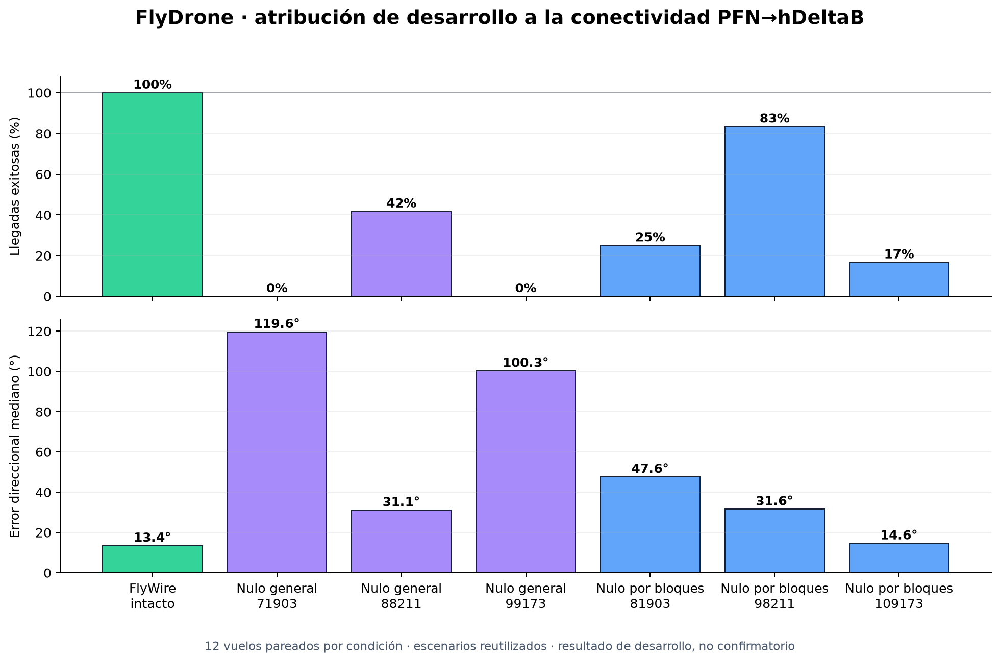

# Atribución al connectoma PFN→hDeltaB: controles nulos de desarrollo

## Pregunta

¿El controlador funciona por la organización PFN→hDeltaB reconstruida de FlyWire, o bastaría cualquier red con el mismo tamaño y una distribución semejante de contactos?

Este documento informa pruebas de desarrollo. Los escenarios ya se habían usado para ajustar y evaluar el sistema, por lo que los resultados no son confirmatorios.

## Diseño común

Todos los controladores recibieron los mismos casos pareados: tres bearings, dos orientaciones iniciales y dos escenarios con viento, ruido, retardo y pérdidas sensoriales. La planta 6DoF, el estimador inercial 3D, el control de yaw, la ganancia de corrección y las semillas del simulador permanecieron iguales.

Cada matriz nula conservó:

- las mismas 61 neuronas PFN y 18 hDeltaB;
- el grado binario de entrada de cada hDeltaB;
- el grado binario de salida de cada PFN;
- el conjunto exacto de pesos de cada fila hDeltaB y, por lo tanto, su peso total de entrada;
- una calibración angular global equivalente a la usada por el modelo intacto.

La suma ponderada por columna no se conservó. Los pesos siguen siendo conteos anatómicos de contactos transformados por el modelo, no eficacias sinápticas fisiológicas medidas.

## Nulo de reconexión general

La primera familia permitió intercambios entre todas las PFN. Se probaron tres matrices, cada una con 5.050 intercambios aceptados.

| Condición | Llegadas | Error direccional mediano | Desvío lateral máximo mediano |
|---|---:|---:|---:|
| FlyWire intacto | 12/12 | 13,44° | 2,16 m |
| Nulo 71903 | 0/12 | 119,60° | 25,27 m |
| Nulo 88211 | 5/12 | 31,13° | 4,46 m |
| Nulo 99173 | 0/12 | 100,28° | 27,39 m |

El intacto superó a cada nulo por 58,3 a 100 puntos porcentuales de llegada. Sin embargo, esta familia también rompe la separación entre PFNd/PFNv y lados, de modo que no distingue la contribución de la identidad celular gruesa del cableado fino.

## Nulo conservando tipo y lado

La segunda familia restringió todos los intercambios a cuatro bloques: PFNd izquierda, PFNd derecha, PFNv izquierda y PFNv derecha. Conservó los mismos invariantes por separado dentro de cada bloque.

| Condición | Llegadas | Error direccional mediano | Tiempo mediano de llegada | Eficiencia mediana |
|---|---:|---:|---:|---:|
| FlyWire intacto | 12/12 | 13,44° | 19,40 s | 0,489 |
| Nulo por bloques 81903 | 3/12 | 47,61° | 30,15 s | 0,149 |
| Nulo por bloques 98211 | 10/12 | 31,59° | 25,71 s | 0,282 |
| Nulo por bloques 109173 | 2/12 | 14,58° | 25,48 s | 0,199 |

El intacto tuvo una ventaja de llegada de 16,7 a 83,3 puntos porcentuales. Frente al nulo más competitivo, la ventaja de 2 vuelos sobre 12 no es concluyente por sí sola (`p=0,25` exacto unilateral, sólo descriptivo), pero el error direccional pareado aumentó 18,58° con intervalo bootstrap de desarrollo de 16,67° a 23,81°. Los otros dos nulos sufrieron degradaciones grandes de llegada y trayectoria.

## Interpretación permitida

Los resultados aportan evidencia de desarrollo de que la correspondencia concreta entre PFN y hDeltaB importa para el comportamiento del modelo. La explicación no se reduce a tener cierto número de neuronas, grados, pesos, tipos PFN o lados. El circuito intacto fue el único que obtuvo 12/12 en ambas familias y mantuvo el menor error direccional frente a todos los nulos por bloques.

Todavía no se puede afirmar que la conectividad de FlyWire sea estadísticamente excepcional. Sólo se probaron tres semillas por familia, los escenarios no eran nuevos y una reconexión conservadora alcanzó 10/12. También queda abierta la posibilidad de que otras matrices no anatómicas produzcan un desempeño igual o superior.

## Próximo gate

El experimento confirmatorio deberá congelar antes de ejecutarse:

1. casos sensoriales y de viento no usados durante el desarrollo;
2. al menos cinco semillas de reconexión por bloques;
3. una métrica primaria de llegada y una secundaria de error direccional;
4. código, configuraciones, hashes y reglas de exclusión;
5. el criterio para comparar FlyWire con la distribución entre matrices, evitando tratar los vuelos de una misma matriz como redes independientes.

Los resultados completos están en `results/simulation/quadrotor_connectome_null_3d_development/` y `results/simulation/quadrotor_connectome_block_null_3d_development/`.
