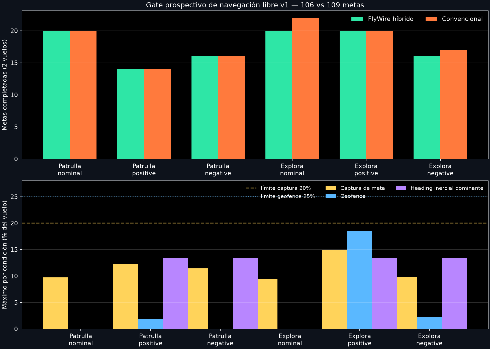

# Resultado: gate operacional de navegación libre v1

Fecha: **2026-11-03**. Estado: **gate prospectivo aprobado, 13/13 criterios**.

## Resultado principal

El controlador FlyWire-grounded híbrido completó **106 metas** en 12 vuelos 6-DoF sellados, frente al mínimo preregistrado de 90. El controlador convencional completó 109; el déficit de 3 quedó dentro del margen máximo de 6. El mínimo híbrido por episodio fue 7 metas, por encima del requisito de 5.

| Efecto congelado | Resultado | Umbral | Estado |
|---|---:|---:|---:|
| Metas híbridas totales | 106 | ≥90 | pasa |
| Mínimo por episodio | 7 | ≥5 | pasa |
| Mediana patrulla | 8 | ≥7 | pasa |
| Mediana exploración | 10 | ≥7 | pasa |
| Déficit frente al convencional | 3 | ≤6 | pasa |
| Escape máximo del espacio | 0% | ≤2% | pasa |
| Geofence máximo | 18,53% | ≤25% | pasa |
| Captura de meta máxima | 14,91% | ≤20% | pasa |
| Mínimo de yaw neural activo | 99,82% | ≥99% | pasa |
| Mínimo de actividad hΔB | 98,49% | ≥90% | pasa |
| Máximo dominio inercial de heading | 13,33% | ≤18% | pasa |
| Colisiones | 0 | 0 | pasa |
| Saturación de motores | 0% | 0% | pasa |

## Qué demuestra

Un modelo FlyWire-grounded del circuito del *central complex* controló de forma continua heading, steering, avance y compensación de deriva de un quadrotor simulado mientras una capa de ingeniería produjo y cambió metas temporales. El sistema completó patrulla y exploración bajo condiciones nominales, viento de ambos signos, ruido, demora y pérdidas temporales de sensores, con desempeño comparable al convencional en esta matriz.

La actividad neural no fue sólo decorativa: el comando neural de yaw estuvo activo al menos 99,82% y hΔB al menos 98,49% de cada vuelo híbrido. Los resultados anteriores de atribución siguen siendo la evidencia de que la identidad de conectividad importa; este gate es operacional y no repite los nulos connectómicos.

## Qué no demuestra

- No demuestra superioridad sobre el convencional: 106 frente a 109 metas es comparabilidad, no ventaja.
- El gestor de patrulla/exploración no es neuronal ni modela toma de decisiones de la mosca.
- La captura de meta, el geofence, la fusión inercial y el estabilizador son ingeniería explícita.
- No existe visión general ni memoria espacial FlyWire-grounded.
- Un pase en simulación no autoriza todavía vuelo físico autónomo.

## Trazabilidad y preservación

- configuración congelada: `configs/free_navigation_gate_v1.yaml`;
- lock: `configs/free_navigation_gate_v1.lock.json`;
- preregistro: `docs/research/free-navigation-gate-v1-preregistration.md`;
- reporte autoritativo: `results/simulation/free_navigation_gate_v1/operational_gate_report.json`;
- 24 trazas: `results/simulation/free_navigation_gate_v1/traces/`;
- archivo preservado: `archive/free_navigation_gate_v1/`.

La auditoría pos-ejecución confirmó **325/325** entradas congeladas sin cambios. El archivo de preservación contiene esas entradas y hashes para los **28** archivos de resultado.

## Próximo paso

La aplicación 3D puede reproducir los 12 pares guardados como `Navegación libre v1`, con meta dinámica, actividad neuronal, captura y geofence sincronizados. La siguiente extensión científica/operacional es percepción simulada de distancia y obstáculos múltiples; debe permanecer como capa de ingeniería antes de investigar una vía visual FlyWire-grounded separada.

