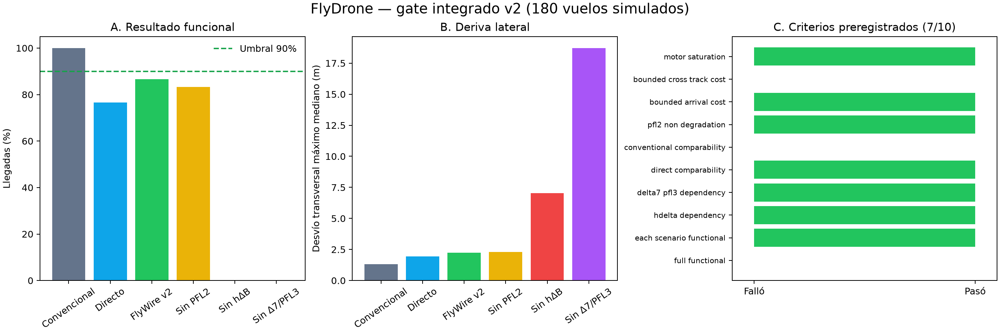

# Resultado del gate integrado FlyDrone v2

## Veredicto

El gate prospectivo integrado **no fue aprobado**: pasaron 7 de 10 criterios congelados. El sistema completo logró 26/30 llegadas (86,7%) frente al mínimo preregistrado de 27/30. El resultado se conserva sin modificar el umbral.

## Resultados

| Condición | Llegadas | Tiempo mediano | Eficiencia | Desvío transversal máximo mediano |
|---|---:|---:|---:|---:|
| Convencional | 30/30 | 20,044 s | 0,604 | 1,322 m |
| Directo pareado | 23/30 | 23,476 s | 0,437 | 1,945 m |
| FlyWire integrado v2 | 26/30 | 23,540 s | 0,418 | 2,246 m |
| Sin PFL2 | 25/30 | 23,690 s | 0,406 | 2,299 m |
| Sin hΔB | 0/30 | — | — | 7,040 m |
| Sin Δ7/PFL3 | 0/30 | — | — | 18,716 m |

## Criterios

Pasaron:

- mínimo de 13/15 por escenario;
- dependencia de hΔB: ventaja 26 éxitos;
- dependencia de Δ7/PFL3: ventaja 26 éxitos;
- comparabilidad con el readout directo;
- no degradación frente a ausencia de PFL2;
- coste de llegada ≤8 s;
- saturación de motores ≤1% (observada: 0%).

Fallaron:

- capacidad primaria: 26/30, requerido 27/30;
- déficit convencional: 4 éxitos, permitido ≤3;
- coste transversal: +0,924 m, permitido ≤0,80 m.

## Auditoría post hoc de los cuatro fallos

Los cuatro vuelos habían satisfecho previamente la llegada y terminaron casi detenidos, pero a 0,310–0,442 m de la meta. La velocidad final fue sólo 0,005–0,015 m/s. El supervisor de ingeniería mantenía la llegada enclavada hasta 0,45 m, mientras el criterio físico exigía permanecer dentro de 0,30 m. Por ello podía mantener el avance y la corrección de deriva apagados en una zona que ya puntuaba como fallo.

Esta inconsistencia explica directamente los cuatro fallos terminales, pero fue detectada después de ejecutar el gate. No se recodifican como éxitos y el gate permanece negativo. Una corrección debe cambiar el radio de liberación en una versión posterior y evaluarse con casos nuevos.

## Interpretación científica

Aunque el gate global falló, produjo una evidencia integrada importante: eliminar hΔB o eliminar Δ7/PFL3 llevó el éxito de 26/30 a 0/30 bajo los mismos casos. Esto respalda que los caminos de desplazamiento y steering son necesarios dentro del controlador computacional completo. PFL2 aportó un éxito adicional, pero no se demuestra necesidad fuerte.

FlyWire obtuvo tres éxitos más que el sustituto directo en este conjunto. Es un resultado descriptivo favorable, no evidencia suficiente para afirmar superioridad general, especialmente porque el convencional obtuvo 30/30 y mejores trayectorias.

## Integridad

- Protocolo: `flydrone_integrated_v2_prospective_v1`.
- Episodios: 180.
- Configuración SHA-256: `de2a27698e08451536ad49c5b768d19cf76c4404cc7643b257c77d91cb4138e3`.
- El lock fue verificado después de la ejecución.
