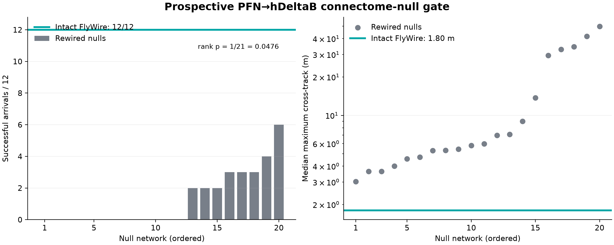

# Prospective v4 PFN-to-hDeltaB connectome-null results

## Verdict

The prospectively frozen PFN-to-hDeltaB attribution gate passed. The intact
FlyWire-grounded projection reached the target in 12/12 paired cases. All 20
rewired null projections performed worse; the best null reached 6/12 and the
median null reached 0/12.

The preregistered one-sided empirical rank test, including its plus-one
correction, was `1/21 = 0.0476`, below the fixed threshold of 0.05. The intact
minimum of 10/12 also passed. These 252 simulated flights therefore satisfy
both parts of the primary gate.

| Primary result | Value |
|---|---:|
| Intact FlyWire-grounded PFN→hDeltaB | 12/12 |
| Null networks | 20 |
| Null success range | 0–6/12 |
| Null median / mean | 0 / 1.25 successes |
| Nulls with zero successes | 12/20 |
| Nulls matching or exceeding intact | 0/20 |
| Empirical rank p, plus-one corrected | 0.0476 |
| Preregistered gate | **PASS** |

## What the null networks preserve

Each null was rewired independently within PFN type-and-side blocks. The
procedure preserves binary row degree, binary column degree, and each hDeltaB
row's exact multiset of nonzero weights inside every block. Consequently, each
hDeltaB neuron retains the same total incoming weight from each block. It does
not preserve weighted column sums or the exact identities of PFN→hDeltaB
partners.

All nulls received the same one-time global angular recalibration allowed by
the preregistration. Sensors, neural dynamics, engineering assistance, drone
plant, perturbations and arrival criteria were otherwise held constant. The
12 paired cases and 20 null seeds were not used in the five-null development
diagnostic.

## Secondary trajectory result

The intact projection had a median maximum cross-track displacement of 1.796
m. Across the 20 null networks, the medians ranged from 3.026 to 49.913 m,
with a median of 5.888 m. Every null network was worse than intact on this
condition-level secondary metric. Cross-track was not the primary gate, so it
supports but does not replace the preregistered arrival-success result.

## Supported claim

Within this computational model and these prospectively frozen scenarios, the
specific FlyWire-grounded PFN→hDeltaB partner arrangement contributes to
successful simulated navigation beyond the block-wise degree distribution and
row-weight statistics preserved by these null networks.

This is stronger than a module-removal ablation: hDeltaB remains present, has
the same number of modeled neurons, and retains the controlled connection and
weight statistics. What changes is which PFN neurons connect to which hDeltaB
neurons within the allowed biological type-and-side blocks.

## Limits

This result is projection-specific. It does not prove that the entire central
complex topology is uniquely necessary, establish causality in a living fly,
or show that FlyDrone outperforms conventional control. The integrated v4
comparison still found 28/30 successes for FlyDrone and 30/30 for both the
matched direct readout and conventional navigation. The rank test also has
coarse resolution: with 20 nulls, 1/21 is the smallest attainable corrected
p-value.

The generic benchmark `report.json` contains `passes_gate: false` because that
runner was deliberately given no generic gate definition. It is not the
statistical decision for this specialized experiment. The authoritative
decision is recorded in `prospective_null_analysis.json`, which evaluates the
frozen rank rule above.

## Reproducibility

- Preregistration: `docs/research/integrated-v4-connectome-null-preregistration.md`
- Frozen configuration: `configs/quadrotor_integrated_v4_connectome_null_prospective.yaml`
- Frozen lock: `configs/quadrotor_integrated_v4_connectome_null_prospective.lock.json`
- Machine-readable result: `results/simulation/quadrotor_integrated_v4_connectome_null_prospective/prospective_null_analysis.json`
- Raw paired episodes: `results/simulation/quadrotor_integrated_v4_connectome_null_prospective/episodes.csv`
- Frozen input archive and output hashes: `archive/integrated_v4_connectome_null/`

## Next attribution test

The next useful experiment is a separate, preregistered null test for the
EPG→Delta7→PFL3 steering pathway. It must preserve explicit projection-level
statistics and use new paired scenarios. That result should remain separate
from the PFN→hDeltaB claim so a positive result in one projection cannot be
mistaken for evidence about all FlyWire connectivity.
