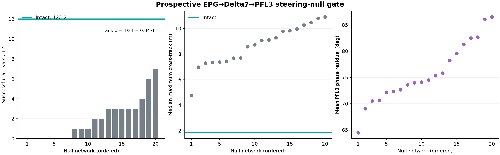

# Prospective v4 EPG→Delta7→PFL3 steering-null results

## Verdict

The prospectively frozen steering-attribution gate passed. The intact
FlyWire-grounded steering pathway completed 12/12 paired cases. All 20 rewired
null pathways performed worse, ranging from 0/12 to 7/12.

The preregistered one-sided empirical rank test with plus-one correction was
`1/21 = 0.0476`, below the fixed 0.05 threshold. Intact also exceeded its
minimum requirement of 10/12. The 252 simulated flights therefore satisfy both
parts of the primary gate.

| Primary result | Value |
|---|---:|
| Intact FlyWire-grounded steering | 12/12 |
| Null networks | 20 |
| Null success range | 0–7/12 |
| Null median / mean | 1.5 / 1.95 successes |
| Nulls with zero successes | 7/20 |
| Nulls matching or exceeding intact | 0/20 |
| Empirical rank p, plus-one corrected | 0.0476 |
| Preregistered gate | **PASS** |

## Controlled change

Each null independently rewired EPG→Delta7 and Delta7→PFL3 within
presynaptic source-side blocks. The procedure preserved binary row and column
degrees and each postsynaptic row's exact nonzero raw-weight multiset inside
every block. It did not preserve weighted column sums or exact partner
identities.

Every null received one algebraic global phase alignment to the intact
composite transfer before flight simulation. Arrival outcomes were not used
for this alignment. Sensors, PFN→hDeltaB, PFL2, neural dynamics, engineering
assistance, perturbations, plant and arrival criteria were otherwise held
constant.

## Secondary results

The intact pathway had a median maximum cross-track displacement of 1.836 m.
The 20 null medians ranged from 4.774 to 10.915 m; every null was worse than
intact on this condition-level secondary measure.

The global phase correction did not recover the nonuniform PFL3 phase
structure. The machine-readable report records the distribution of residual
phase errors for all nulls. These values are secondary mechanistic evidence;
arrival success remains the preregistered primary endpoint.

## Supported claim

Within this computational model and the prospectively frozen scenarios, the
specific FlyWire-grounded partner arrangements across the jointly tested
EPG→Delta7 and Delta7→PFL3 projections contribute to successful simulated
navigation beyond the block-wise degree and row-weight statistics preserved by
the null networks.

This result complements the independently passed PFN→hDeltaB null gate. It is
stronger than simply removing Delta7/PFL3 because every null retains all three
populations and controlled connection statistics.

## Limits

Both projections were rewired simultaneously, so this experiment cannot say
how much of the effect belongs specifically to EPG→Delta7 versus
Delta7→PFL3. It does not test the entire central-complex topology, establish
causality in a living fly, or demonstrate superiority over conventional
control. With 20 null networks, `1/21` is also the minimum possible corrected
rank p-value.

The generic benchmark `report.json` contains `passes_gate: false` because the
generic runner was deliberately given no standard integrated-gate definition.
That field is not the decision for this specialized rank experiment. The
authoritative decision is stored in `prospective_steering_null_analysis.json`.

## Reproducibility

- Preregistration: `docs/research/integrated-v4-steering-null-preregistration.md`
- Frozen configuration: `configs/quadrotor_integrated_v4_steering_null_prospective.yaml`
- Frozen lock: `configs/quadrotor_integrated_v4_steering_null_prospective.lock.json`
- Raw paired episodes: `results/simulation/quadrotor_integrated_v4_steering_null_prospective/episodes.csv`
- Machine-readable analysis: `results/simulation/quadrotor_integrated_v4_steering_null_prospective/prospective_steering_null_analysis.json`
- Frozen input archive and original result hashes: `archive/integrated_v4_steering_null/`

## Next step

The next attribution experiment should test decoder compatibility: fit the same
small, regularized output decoder separately to intact and null representations
using development data, then evaluate it on sealed cases. This would determine
whether rewiring destroys navigation information or primarily makes that
information incompatible with the fixed FlyWire-oriented readout.
